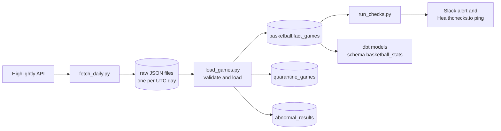

# Basketball Data Pipeline

A daily basketball data pipeline that turns messy sports API data into clean, validated, analysis-ready tables.

It fetches games from the Highlightly API, keeps every raw response, and loads games into Postgres only after validation. Bad records go to a quarantine table and are never silently dropped.

dbt models then turn the clean games into one row per team per game, ready for form and head-to-head statistics.

Airflow runs it every morning in Docker, with Slack alerts on failure and a dead man's switch that warns you if it doesn't run at all.

Built with Python, SQL, Postgres, Airflow, dbt and Docker.

---

## Why this exists

A sports statistics platform is only as good as its history. Sports APIs send scores that get revised, teams that share ids, forfeited games recorded as 20-0, and quarters that don't add up. This repo is the data foundation: it collects the past results, checks them, and keeps them in a shape that anything downstream (statistics, backtesting, a backend) can trust.

It covers the data side only: ingestion, storage, validation, scheduling, alerting and transformation. It does no statistics or predictions.

## Architecture



Airflow (Docker) runs fetch, load, checks and alerts every day at 06:00 UTC. dbt reads `fact_games` and builds `stg_basketball__games` (a view) and `team_games` (a table).

## Tech stack

| Layer | Tools |
|---|---|
| Language | Python 3.11, SQL |
| Storage | Postgres (tables), raw JSON files (system of record) |
| Orchestration | Apache Airflow 3 in Docker Compose (LocalExecutor) |
| Transformation | dbt Core 1.12 with the Postgres adapter |
| Alerting | Slack webhooks, Healthchecks.io (dead man's switch) |

## Key engineering decisions

- **Raw data is kept.** Every API response is saved as a file before anything touches it. An incomplete fetch never replaces a good file. Re-fetched days produce a change report, which is how score revisions were discovered.
- **Quarantine, don't drop.** A game that fails validation goes to `quarantine_games` with the reason and the full raw record. Nothing disappears silently, and a game that loads cleanly later is marked fixed automatically.
- **Shared team ids are handled explicitly.** The API sometimes uses one team id for two different clubs. The pipeline maps each game to its own `club_id` through lookup tables, and `run_checks.py` fails if one `club_id` ever carries two club names.
- **Forfeits are separated.** Games with a 0 score and no quarter data (walkovers, forfeits) go to `abnormal_results`, so they cannot distort team statistics.
- **Idempotent by design.** Loads use upserts, one transaction per file, so any step can be re-run safely.
- **One clock.** Every kickoff time is converted to UTC when loaded. The dbt models use a strict "only games before kickoff" rule so no statistic can use the future.
- **Failures are loud, silence is caught.** Red and green Slack messages cover failed runs. The dead man's switch covers the case where the pipeline never ran at all.
- **dbt is rebuildable.** dbt writes only to its own schema (`basketball_stats`). If it breaks, drop the schema and run `dbt run`; the loaded data is untouched.

## Data model

Schema `basketball` (written by the pipeline):

| Table | Purpose |
|---|---|
| `fact_games` | One row per finished, valid game |
| `quarantine_games` | Games that failed validation, with the reason |
| `abnormal_results` | Forfeits and walkovers, set aside |
| `club_id_overrides`, `club_corrections` | Map shared API team ids to the right club |
| `league_corrections`, `half_style_leagues`, `international_leagues` | Lookup tables for league quirks |

Schema `basketball_stats` (written by dbt):

| Model | Stored as | Purpose |
|---|---|---|
| `stg_basketball__games` | view | Cleaned, renamed copy of `fact_games` with a UTC `kickoff_at` |
| `team_games` | table | One row per team per game (about 306,000 rows) |

As of 2026-11-05: 153,223 games loaded (2023-02 to 2026-11), 303 forfeits set aside, 118 games in quarantine awaiting review.

## Quick start

Requirements: Python 3.11, Postgres, Docker Desktop, a Highlightly API key.

```bash
git clone <this repo>
cd <this repo>
python -m venv venv
source venv/Scripts/activate     # Windows (Git Bash). On Linux/macOS: source venv/bin/activate
pip install -r requirements.txt  # installs the scripts' packages, including pinned dbt
cp .env.example .env             # then fill in your own values; .env is never committed
```

Create the tables, then run the pipeline by hand:

```bash
psql -d sports_intelligence_db -f sql/01_schema.sql         # create schema and tables
psql -d sports_intelligence_db -f sql/02_seed_lookups.sql   # fill lookup tables
python fetch_daily.py     # fetch yesterday and the day before into raw/
python load_games.py      # validate and load into Postgres
python run_checks.py      # sanity checks; exit code 1 if one fails
```

Build the dbt models (dbt does not read `.env`, so load it first):

```bash
set -a; source .env; set +a   # export the variables in .env to this terminal
cd dbt
dbt debug                     # check config and database connection
dbt run                       # build the models
```

Run it on a schedule with Airflow:

```bash
docker compose up -d          # start Airflow; UI at http://127.0.0.1:8080
```

The detailed operating guide, with step-by-step procedures for failures and data fixes, is in [docs/RUNBOOK.md](docs/RUNBOOK.md).

## Status and roadmap

| Area | Status |
|---|---|
| Ingestion, raw storage, validation, quarantine | Done |
| Airflow schedule, Slack alerts, dead man's switch | Done |
| Data-quality checks (`run_checks.py`) | Done |
| dbt staging and `team_games` models | Done |
| dbt form and head-to-head models | In progress |
| dbt tests, dbt as Airflow tasks | Next |
| S3 backup of raw files, CI with GitHub Actions | Planned |
| Move off the laptop to an always-on server | Planned |

The full plan is in [docs/ROADMAP.md](docs/ROADMAP.md).

## Known limitations

Stated honestly, because they are part of the picture:

- It runs on a laptop with Docker Desktop. If the machine is off at 06:00 UTC, the run is caught up later, and the dead man's switch tells me.
- The raw files are not yet backed up to cloud storage (S3 is planned). They cannot be refetched quickly, because the API allows about 100 requests a day.
- dbt tests and CI are not written yet; today the checks are in `run_checks.py` and the loader's validation.
- 118 games are still in quarantine, mostly zero-quarter scores, missing final scores and a few unresolved shared team ids. They are tracked, not hidden.
- dbt connects with a superuser account for now; a limited user is planned.
- Only one data source (Highlightly) is used.

## Repo layout

```
fetch_daily.py, backfill.py     extract
load_games.py                   validate and load
run_checks.py                   data-quality checks
highlightly_client.py           shared API code
dags/                           Airflow DAG, Slack alert, heartbeat ping
dbt/                            dbt project (models, sources, profile)
sql/                            schema and lookup-table seeds
docs/                           runbook and roadmap
docker-compose.yml, Dockerfile  Airflow stack
```

## Secrets

All credentials live in `.env`, which is excluded from Git. `.env.example` lists the keys with placeholder values. The Slack webhook and the Healthchecks.io URL are treated as secrets too.